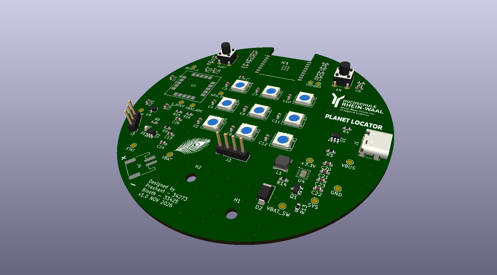

# Planet Locator – GPS Planet Finder

Battery-powered board that shows which planets are in your sky right now. It gets time and position from GPS, calculates where the Moon and planets are directly on an ESP32-C3, and lights an LED for every planet higher than 25° above the horizon. Designed in KiCad 10, 2-layer round PCB made by AISLER, hand-assembled. Group project with Bineth for Practical Electronics (WS 2026) at Rhine-Waal University.

## Specs

| | |
|---|---|
| **MCU** | ESP32-C3-WROOM-02-N4 (RISC-V 160 MHz, 4 MB flash, native USB) |
| **GPS** | u-blox SAM-M10Q, built-in patch antenna, UART at 9600 baud |
| **Output** | 9 × WS2812B RGB LEDs (one per body) + SSD1306 OLED over I²C |
| **Battery** | 1-cell Li-Po, JST PH, built-in protection |
| **Charging** | Microchip MCP73831, 500 mA, 4.2 V |
| **3.3 V supply** | TI TPS63001 buck-boost (works from 1.8 V to 5.5 V input) |
| **Power path** | SS14 Schottky (USB) + DMG2301L P-MOSFET (battery), load sharing |
| **GPS backup** | MCP1700 LDO from the battery, always on |
| **USB** | USB-C (5.1 kΩ CC pull-downs), USBLC6-2 ESD protection, 22 Ω series |
| **Inputs** | EN and BOOT buttons (BOOT doubles as user button), slide switch |
| **PCB** | 2 layers, Ø 90 mm round, 1.6 mm, 0603 parts, AISLER design rules |

## How it works

The planet positions are calculated live on the chip with Paul Schlyter's method, with no lookup tables:

1. GPS gives UTC time, latitude and longitude
2. Day number since 1 Jan 2000
3. Six orbital elements per planet, then Kepler's equation gives the position around the Sun
4. Move the centre from the Sun to the Earth (plus three corrections for the Moon)
5. Tilt by Earth's axis to get right ascension and declination
6. Local sidereal time turns that into altitude and compass direction
7. LED on if the planet is more than **25°** above the horizon

Checked against the PyEphem library: within **0.3°**, and the 25° on/off decision matched in **2700 of 2700** test cases.

## Design decisions

**Stable 3.3 V (TPS63001):** a buck-boost converter keeps exactly 3.3 V from a full battery (4.2 V) down to an empty one. The ESP32 never browns out, and the LEDs keep the same colour and brightness all the way down.

**Charge and play:** when USB is plugged in, it powers the board through an SS14 Schottky diode while the MCP73831 charges the battery. A DMG2301L P-MOSFET switches the board back to the battery the moment USB is unplugged.
- `PROG = 2 kΩ` → 1000 / 2000 = **500 mA** charge current
- The `STAT` output drives a green charging LED

**Works indoors:** the last GPS position is saved in flash. A separate MCP1700 LDO keeps the GPS backup domain alive from the battery even when the switch is off, so time and satellite data are ready immediately.

**Battery level:** a 100k/100k divider on the *switched* battery line feeds the ADC, so it draws nothing when the board is off.

**Reset:** 10 kΩ + 1 µF on EN, as Espressif recommends.

**PCB:**
- 2 layers, round, 90 mm across
- The ESP32 antenna sits over an 18 mm cut-out with no copper underneath
- Ground pour on both sides, tied together with 130 vias
- 0.4 mm power tracks
- USB routed as length-matched differential pairs
- 14 test points on every power rail, GPS, UART0 and the charger status
- 2 × M3 mounting holes

## Pin map

| Function | GPIO |
|---|---|
| GPS UART RX / TX | IO5 / IO6 |
| LED data (WS2812B chain, 330 Ω) | IO4 |
| OLED SDA / SCL | IO0 / IO1 |
| Battery voltage (ADC) | IO3 |
| BOOT / user button | IO9 |
| USB D− / D+ | IO18 / IO19 |
| UART0 TX / RX (test pads) | TX0 / RX0 |

**LED chain order:** Mercury → Venus → Mars → Jupiter → Saturn → Uranus → Neptune → Pluto → Moon

## Status

- [x] Planet maths verified on an ESP32 dev board + NEO-7M GPS
- [x] Breadboard test: LEDs, OLED, LEDs on 3.3 V
- [x] Schematic and PCB layout, 0 ERC errors, PCB ordered at AISLER
- [ ] Assembly and bring-up
- [ ] Firmware on the final ESP32-C3 pin map
